<!-- Animated wave banner -->

<!-- Animated typing header -->

 

---

## 👨‍🚀 About Me

I'm an Astronautical Engineering student at **Istanbul Technical University** (GPA: 3.3/4), passionate about the intersection of **space systems**, **orbital mechanics**, and **data-driven engineering**. Currently an undergraduate research fellow at **TÜBİTAK UZAY**, contributing to Turkey's lunar exploration ambitions.

- 🌙 Developing spacecraft simulation models for the **Turkish Lunar Mission (AYAP/TLM)**
- 🛸 Designed transfer trajectories for **asteroid 85990 JV6** using Lambert solutions
- 🌍 Erasmus+ exchange at **Brno University of Technology** (GPA: 3.91/4)
- 🏆 **3rd Place** at İstanbul Designathon 2024
- 🌱 Challenger Fellow at **Turkish Entrepreneurship Foundation**

---

## 🪐 Where Is My Asteroid Today?

Generated daily by a Python script from <a href="https://ssd-api.jpl.nasa.gov/doc/sbdb.html">JPL Small-Body Database</a> orbital elements — Keplerian propagation, one Earth year ≈ 12 s.

---

## 🛠️ Skills & Tools

**Programming & Data**

**Python Libraries**

`AstroPy` · `poliastro` · `Rebound` · `Skyfield` · `pandas` · `NumPy` · `scikit-learn` · `TensorFlow` · `Matplotlib` · `Plotly`

**Domain Expertise**

🛰️ Orbital Mechanics & Astrodynamics · 🎯 Satellite Attitude Dynamics & Control · 🌌 Interplanetary Trajectory Design · 📊 Data Analysis & Visualization · 🤖 Machine Learning

---

## 📡 Latest in Astrodynamics on arXiv

<!-- ARXIV:START -->
- 📄 *The feed updates automatically every day via GitHub Actions.*
<!-- ARXIV:END -->

---

## 📊 GitHub Activity

  

<picture>
  <source media="(prefers-color-scheme: dark)" srcset="https://raw.githubusercontent.com/yazicmert/yazicmert/output/github-snake-dark.svg"/>
  <source media="(prefers-color-scheme: light)" srcset="https://raw.githubusercontent.com/yazicmert/yazicmert/output/github-snake.svg"/>
  
</picture>

---

## 📜 Certifications

| Certificate | Institution | Year |
|---|---|---|
| Google Data Analytics Professional | Google / Coursera | 2026 |
| Management of Innovation and Common Good | Pisa, Italy | 2026 |
| Machine Learning | Stanford University / Coursera | 2024 |
| EELISA Prototype Contest | Nürnberg, Germany | 2024 |

---

*Open to research collaborations, internship opportunities, and space tech discussions!*

