<!-- Animated wave banner -->

<!-- Animated typing header -->

 

---

## 👨‍🚀 About Me

I'm an Astronautical Engineer from **Istanbul Technical University**, now pursuing an **M.Sc. in Space Engineering at the University of Bremen**. My focus is **autonomous lunar landing** — hazard assessment, flight dynamics and mission simulation — built on research for Türkiye's lunar mission at **TÜBİTAK UZAY** and presented at **IAC 2026**.

Powered descent simulated with E-guidance under lunar gravity, with a hazard scan that retargets the lander to a safe site. The Moon phase updates daily.

### 🎓 Education

- **University of Bremen** — M.Sc. Space Engineering · *2026 – Present*
- **Istanbul Technical University** — B.Sc. Astronautical Engineering · *Graduated 2026* (GPA: 3.3/4)
- **Brno University of Technology** — Erasmus+ exchange semester · *Feb – Jun 2025* (GPA: 3.91/4)

### 🚀 Experience

**TÜBİTAK UZAY** — Orbit, Attitude and Control Group · Ankara

- **Undergraduate Research Fellow, Turkish Lunar Mission (AYAP/TLM)** · *Oct 2025 – Jul 2026*
  - Developed a system-level spacecraft simulation model in **MATLAB/Simulink**
  - Implemented flight dynamics and lunar mission scenario simulations
  - Built a graphical flight simulation interface for visualization and user interaction
- **Research Intern** · *Jun 2025 – Sep 2025*
  - Designed transfer trajectory concepts for **asteroid 85990 JV6** using Lambert solutions
  - Analyzed launch windows and ΔV requirements for mission feasibility
  - Contributed to propulsion and orbital analysis studies within TLM

**Turkish Entrepreneurship Foundation** — Challenger Fellow · *2023 – 2024*

### 🏆 Research & Awards

- **IAC 2026, Antalya** — Presented *"Learning-Assisted Multi-Sensor Hazard Assessment and Decision Support for Autonomous Lunar Landing"* (Symposium A3, Space Exploration · IAC-26,A3,IP,172)
- **AIAA 2025/2026 Space Systems Design Competition — 2nd Place** among 29 international teams (Team Ares Aegis) with *HELIOS-Net*, a multi-point space weather monitoring constellation for Sun–Earth–Mars connectivity
- Invited by the AIAA Space Systems Technical Committee to present HELIOS-Net at **AIAA SciTech Forum 2027**, Orlando
- **3rd Place** — İstanbul Designathon 2024 (ISO ETP)

---

## 🛠️ Skills & Tools

**Programming & Data**

Also: R · GNU Octave · Jupyter · Git · VS Code

**Python Libraries**

`AstroPy` · `poliastro` · `Rebound` · `Skyfield` · `pandas` · `NumPy` · `scikit-learn` · `TensorFlow` · `Matplotlib` · `Plotly`

**Domain Expertise**

Orbital Mechanics & Astrodynamics · Satellite Attitude Dynamics & Control · Interplanetary Trajectory Design (Lambert, patched conics, rendezvous) · Spacecraft Simulation · Data Analysis & Visualization · Machine Learning

---

## 📊 GitHub Activity

---

## 📜 Certifications

| Certificate | Institution | Year |
|---|---|---|
| Google Data Analytics Professional | Google / Coursera | 2026 |
| Management of Innovation and Common Good | Pisa, Italy | 2026 |
| Machine Learning | Stanford University / Coursera | 2024 |
| EELISA Prototype Contest | Nürnberg, Germany | 2024 |

---

*Open to research collaborations, internship opportunities, and space tech discussions.*

